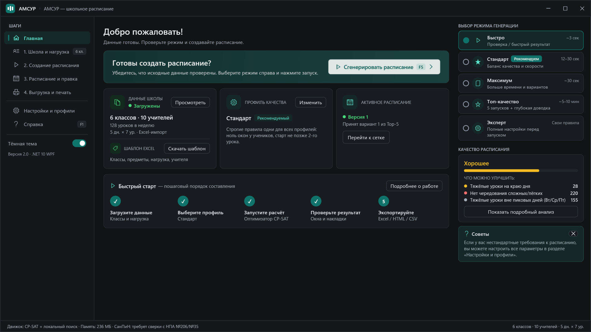
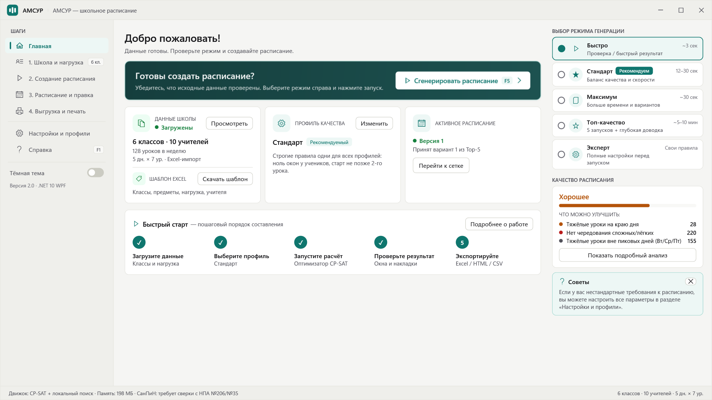
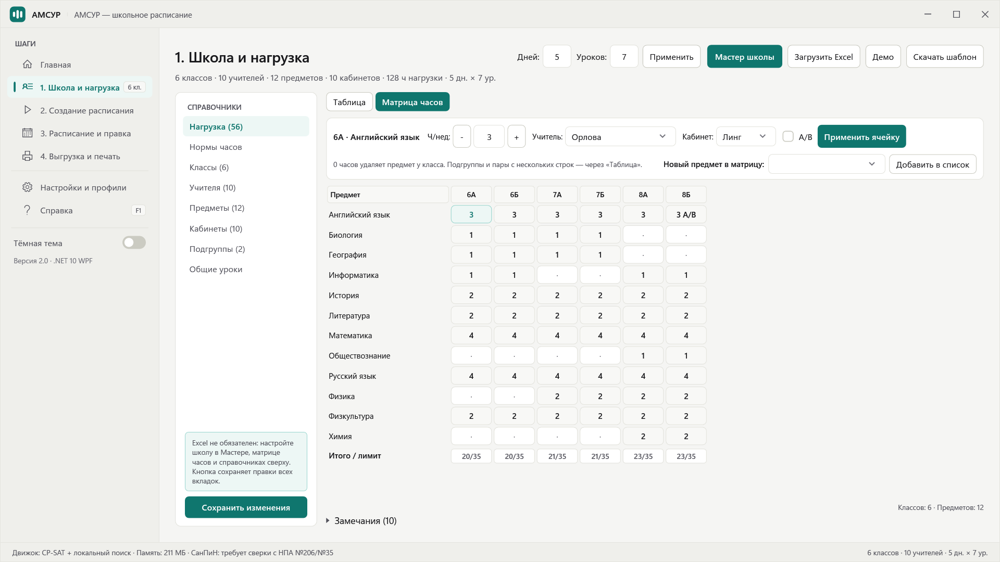
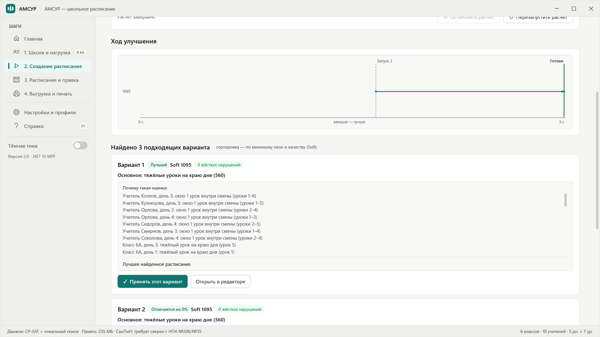
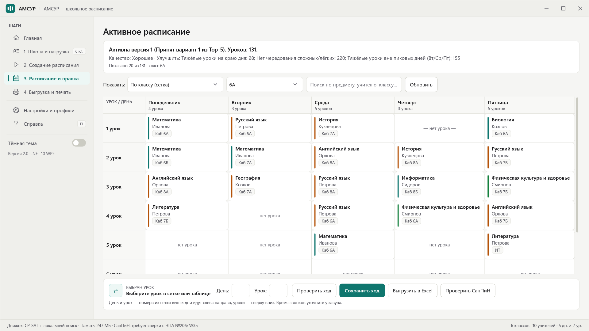
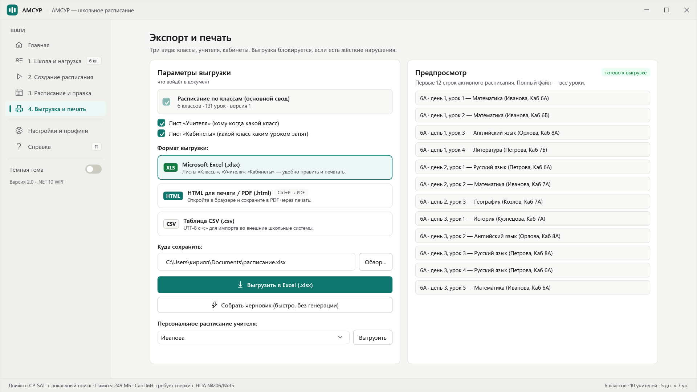

# АМСУР v2.0 — автоматическое составление школьного расписания

Бесплатное офлайн-приложение с открытым исходным кодом (`MIT`) для завуча двухсменной школы: ввод нагрузки без обязательного Excel → **до 5 непохожих вариантов с разбором причин словами** → безопасная ручная правка со светофором → выгрузка в Excel, HTML и CSV.

- Скачать готовый автономный `.exe` для Windows 10/11 x64: **[Releases v2.0](https://github.com/LuMon1xxx/AMSUR/releases/tag/v2.0)** (установка, права администратора и интернет не нужны).
- Следующая версия в разработке: **[АМСУР v3.0 (LuMon1xxx/AMSUR-v3)](https://github.com/LuMon1xxx/AMSUR-v3)** (новый интерфейс на React + WebView2, центр диагностики ошибок, модуль утренних замен, печать с официальной шапкой и портативный режим с флешки).

---

## Интерфейс АМСУР v2.0

| Главный экран (тёмная тема) | Главный экран (светлая тема) |
|---|---|
|  |  |

| Ввод без Excel («Матрица часов») | 5 вариантов с разбором причин |
|---|---|
|  |  |

| Сетка и светофор ручной правки | Выгрузка в Excel / HTML / CSV |
|---|---|
|  |  |

---

## Возможности и принцип «максимально гибко, максимально просто»

- **Настройка без Excel и импорт Excel:** «Мастер школы» (1–11 классы и 2 смены за ~30 секунд), «Матрица часов» (учитель, кабинет, подгруппы A/B, сдвоенные уроки кликом по ячейке), сетка недоступности учителей, предварительная диагностика перегрузов и совместимость с шаблоном Excel.
- **Гибкие правила без кода:** жёсткие законы (`Hard = 0`: коллизии учителей/классов/кабинетов, смена класса, синхронность A/B и пар, 0 окон у учеников, старт не позже 2-го урока, дневной лимит) отделены от мягких приоритетов с готовыми профилями («Стандарт», «Удобно ученикам», «Удобно учителям», «Моя школа») и тонкой настройкой.
- **Гибридный конвейер расчёта:** `GreedyPlacer` → `CompactRepair` → `OR-Tools CP-SAT` (Phase A + Phase B для школ `< 300` уроков) → `LocalSearch VND` с быстрым индексом `SearchIndex` → эвристики `GrindLite` (LNS) → независимый валидатор `PlacementValidator`.
- **Повторяемость по `seed` и Top-5:** детерминированный расчёт без нейросетей и облака; похожие сетки отбрасываются; у каждого варианта — оценка словами и 3 главные причины с именами класса, учителя и дня.
- **Безопасная ручная правка и экспорт:** прогноз допустимости хода до клика («Можно», «Можно с ухудшением», «Запрещено» + причина); выгрузка в Excel (3 листа), HTML для печати и CSV; светлая и тёмная темы.

---

## Замеры и тестирование

- **Реконструкция нагрузки СШ № 8 г. Жодино** (24 класса 5–11, 404 строки, 768 ч/нед, **890 уроков-позиций** с подгруппами, 2 смены, фамилии обезличены):
  - размещено **890 / 890**, `Hard = 0`, **0 окон у учеников**, **0 стартов позже 2-го урока**;
  - первое допустимое решение: **~2 с**, 1 вариант: **~30 с**, 5 разных вариантов: **~100 с**.
- **Синтетический стресс-стенд** (40 классов, ~100 учителей, **1196 уроков** в 2 смены):
  - жадный старт: **~0,1 с**;
  - доводка снижает окна учителей с **285 до 162 (−43%)** при **0 окон у учеников** и `Hard = 0`.
- **Автотесты:** **515 пройденных** тестов, 11 объявленных пропусков (карантин/долгие кампании), **0 падений**.

---

## Стек и запуск из исходников

Стек: `.NET 10`, `C#`, `WPF` (MVVM), `SQLite` (`Microsoft.Data.Sqlite`), `Google OR-Tools CP-SAT` + собственный локальный поиск, `ClosedXML`.

```powershell
dotnet build src/Amsur.slnx --nologo -v minimal
dotnet test src/Amsur.Tests/Amsur.Tests.csproj --no-build
# Запуск настольного приложения:
dotnet run --project src/Amsur.Wpf/Amsur.Wpf.csproj
```

---

## Честные ограничения

- Алгоритм ищет **лучшее найденное** расписание за отведённое время (`NP`-трудная задача, глобальный оптимум не гарантируется; таймаут означает «нужно больше времени», а не «невозможно»).
- Блок проверки СанПиН помечен **`NEEDS-CHECK`** и требует сверки с завучем; юридическое соответствие НПА не заявляется.
- Нагрузка СШ № 8 (890 позиций) в версии v2.0 реконструирована по сетке расписания и уточнениям учителей; официальный пилот на живых данных школы запланирован на **декабрь 2026**.
- В версии v2.0 нет проверки числа парт в кабинетах, потоковых объединений разных классов и автоматических замен заболевшего учителя (автозамены и официальная печать уже добавляются в **[АМСУР v3.0](https://github.com/LuMon1xxx/AMSUR-v3)**).

---

## Документы и лицензия

- Карта документации: [`docs/README.md`](docs/README.md) · Статус: [`docs/PROJECT_STATUS.md`](docs/PROJECT_STATUS.md) · Архитектурные решения: [`docs/DECISIONS.md`](docs/DECISIONS.md) · Нормы РБ: [`docs/SANPIN_RB.md`](docs/SANPIN_RB.md).
- Лицензия: **MIT** — см. [`LICENSE`](LICENSE).
